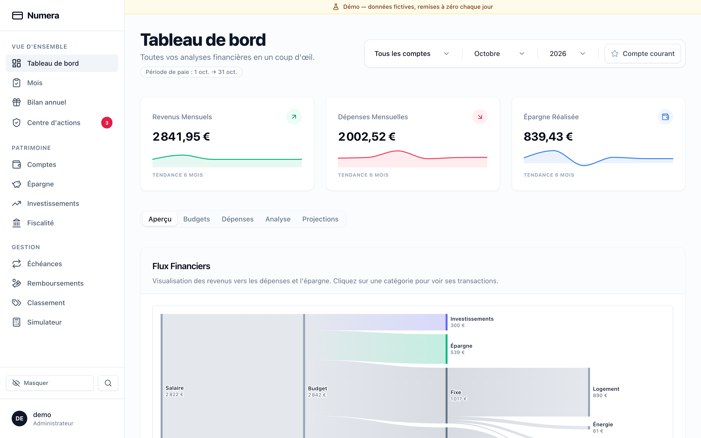
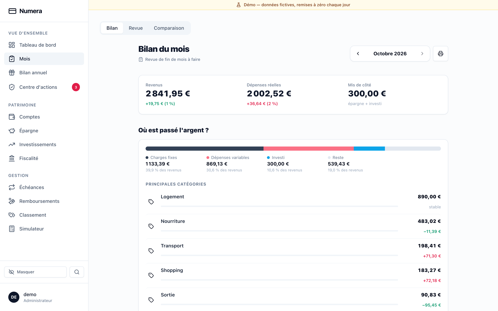
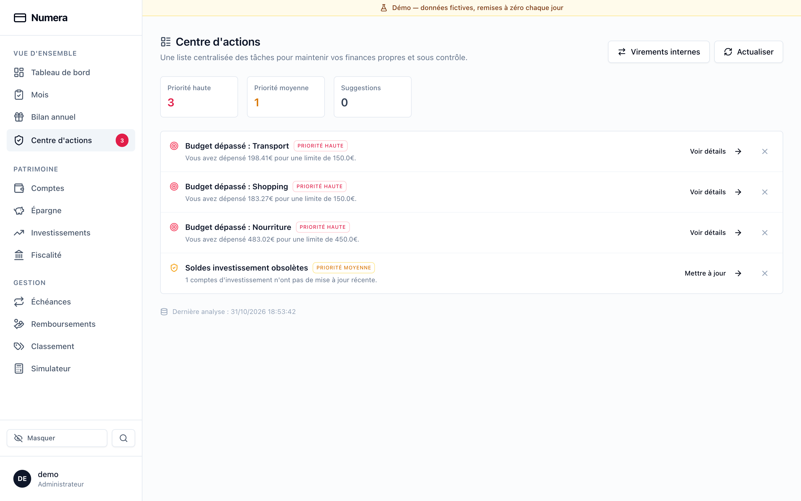
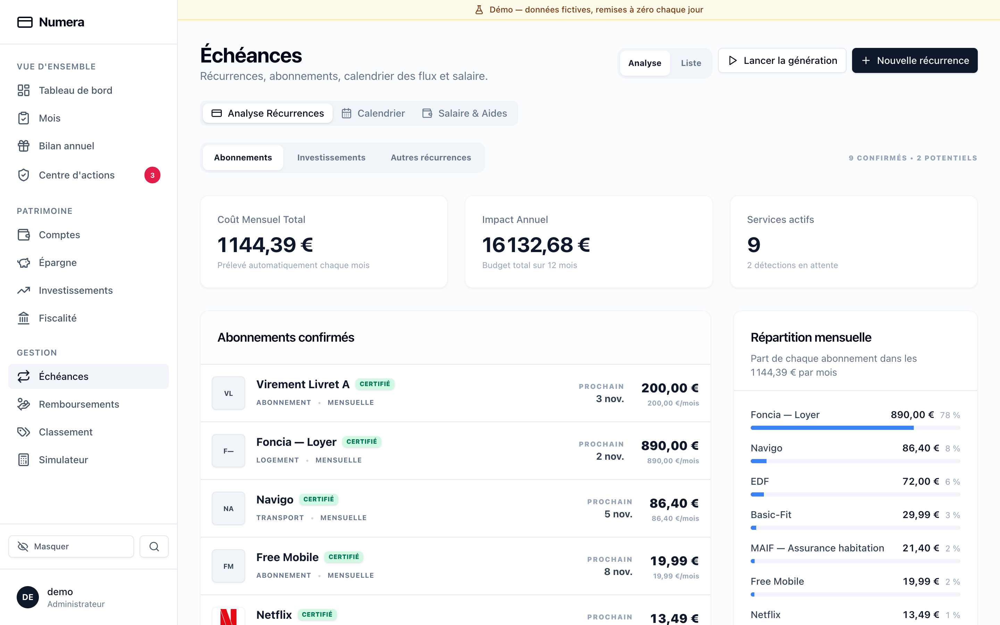
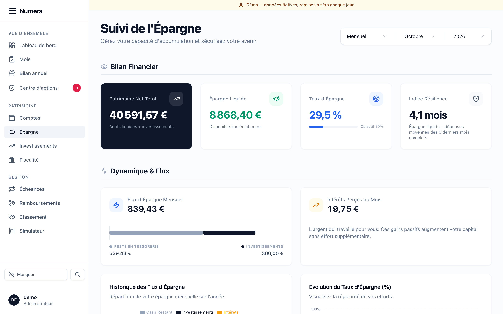
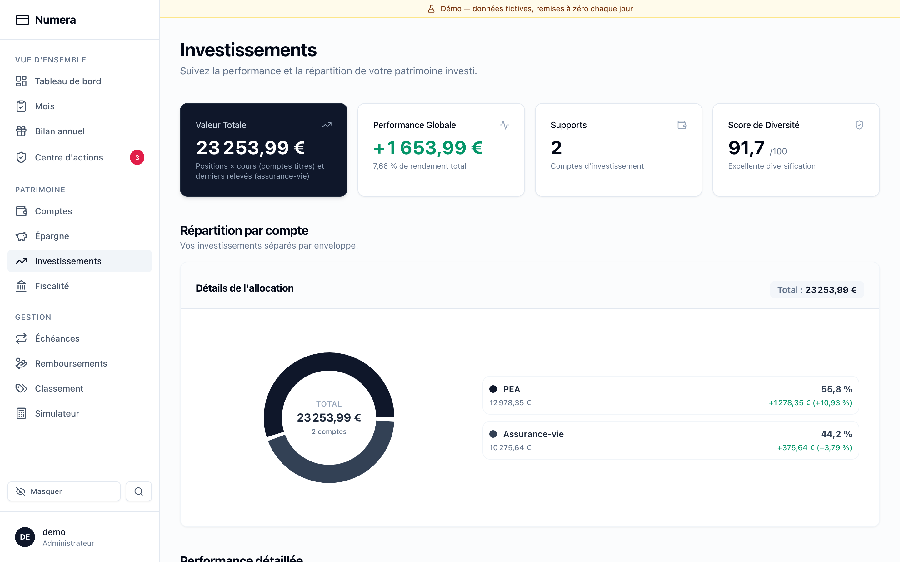

<div align="center">

<h1>Numera</h1>

<p><strong>Your budget, savings and investments in one place. At home.</strong></p>

<p>
  <a href="https://demo-budget.galleyhugo.com"></a>
</p>

<p>
  
  
  
  
  <a href="LICENSE"></a>
</p>

<p>
  <a href="#-the-demo">Demo</a> ·
  <a href="#-installation">Installation</a> ·
  <a href="#-what-numera-does-for-you">Features</a> ·
  <a href="#-ask-claude">Claude</a> ·
  <a href="#-development">Development</a>
</p>

<br>



</div>

<br>

> [!NOTE]
> The interface is available in **French, English and Spanish** (language picker in Settings → Display; the screenshots below show the French one). Documentation, code conventions and contributor guides are in English.

For a long time I tracked my budget and my investments in a spreadsheet. It worked, until there were too many tabs, too many fragile formulas, and no desire left to open it. **Numera** is the application I wrote to replace it.

- 🏠 **Your data stays at home**: a plain SQLite file on your machine, no account to create, no cloud.
- 🔌 **Nothing is connected to your bank**: you import your CSV statements whenever you want.
- 🌍 **The only outbound calls** are for exchange rates and stock prices.
- 👤 **Designed for one person**: no multi-user machinery.

<br>

## 🎮 The demo

The easiest way to get an idea is to click around:

<p align="center">
  <a href="https://demo-budget.galleyhugo.com"><strong>👉 demo-budget.galleyhugo.com</strong></a><br>
  <sub>username <code>demo</code> · password <code>demo</code> (already filled in)</sub>
</p>

The data is fictitious and reset every day: edit, delete, import, nothing can break.

<br>

## 🚀 Installation

You need **Docker** (with Compose), `openssl` and `curl`. A single command:

```bash
bash -c "$(curl -fsSL https://raw.githubusercontent.com/Hugo-Galley/numera/main/install.sh)"
```

The script offers two modes. Choose **1) Docker**:

| Mode | Who it is for | What happens |
|---|---|---|
| **1) Docker** (recommended) | everyone | downloads the **ready-to-use images** of the latest [release](https://github.com/Hugo-Galley/numera/releases) (`amd64` and `arm64`, so Raspberry Pi and ARM NAS too): **nothing to clone, nothing to build**, installed in a minute; everything lives in `./numera` |
| 2) From source | to modify the code | clones the repository and builds the containers on your machine (a few minutes) |

The script asks for a username and a password, takes care of everything else, and Numera runs on **http://localhost:8082**. You can safely rerun it: it keeps your configuration. To skip the prompts: `NUMERA_MODE=docker` (or `source`), and `NUMERA_VERSION=0.1.0` for a specific version.

> [!IMPORTANT]
> Your backups are encrypted with the `BACKUP_KEY` from the `.env` file. **Keep it safe** (in a password manager, for example): without it, a backup is unreadable.

> [!TIP]
> Want to try it locally with fictitious data? From a clone, run `make backend-seed-demo`.

<details>
<summary><strong>Install by hand with Docker (without the script)</strong></summary>

<br>

In an empty folder, fetch the compose file of the latest release, create your `.env` (`SECRET_KEY`, `ADMIN_PASSWORD_HASH`, `BACKUP_KEY`: see below) and run:

```bash
curl -fsSLO https://github.com/Hugo-Galley/numera/releases/latest/download/docker-compose.yml
docker compose --env-file .env up -d
```

</details>

<details>
<summary><strong>Install from source</strong></summary>

<br>

```bash
git clone https://github.com/Hugo-Galley/numera.git
cd numera
./install.sh        # automatically picks the "source" mode from a clone
```

</details>

<details>
<summary><strong>Configure everything by hand</strong></summary>

<br>

```bash
make setup                                        # creates .env, generates SECRET_KEY and BACKUP_KEY
python3 scripts/ops/change_password.py 'password'     # requires bcrypt (pip install bcrypt)
```

Paste the resulting hash into `.env` **between single quotes**, otherwise Docker Compose treats the `$` as variables and login fails:

```env
ADMIN_PASSWORD_HASH='$2b$12$...'
```

Then run `make prod`.

</details>

<details>
<summary><strong>Reach it from your phone</strong></summary>

<br>

By default the app only listens on `127.0.0.1:8082`. To open it from outside, put an HTTPS reverse proxy in front: Caddy, Traefik, Nginx or a Cloudflare tunnel. The API (`/api`) and the MCP server (`/mcp`) go through that same port, there is nothing else to expose.

</details>

### Updating

**Docker mode**: in `./numera` (or by rerunning the install script, which keeps your configuration):

```bash
bash -c "$(curl -fsSL https://raw.githubusercontent.com/Hugo-Galley/numera/main/install.sh)" _ --upgrade
```

(from a clone of the repository: `./install.sh --upgrade`)

The `docker-compose.yml` published with each release pins the image version: a plain `docker compose pull && up -d` downloads the **same** version again and therefore updates nothing. `--upgrade` downloads the compose file of the latest release again (`SHA256SUMS` checksum verified), backs up the database, pulls the images and restarts. For a specific version or to roll back: `NUMERA_VERSION=0.1.0 NUMERA_UPGRADE=1 bash -c "$(curl -fsSL …/install.sh)"`. Database migrations do not undo themselves: when rolling back, restore the `pre_migration_*` backup made before the update.

**From source**:

```bash
make upgrade
```

The latest version is fetched and the containers rebuilt. In both cases, the database updates itself on startup, after a safety copy in `backups/` (`pre_migration_<revision>_<date>.db[.enc]`, the last 5 are kept) when the schema has to change.

### Backups

Every 24 hours, an encrypted copy of the database is dropped into `backups/`, and the last 7 days are kept (adjustable through `BACKUP_INTERVAL_SECONDS`, `RETENTION_DAYS` and, for GitHub, `GITHUB_BACKUP_KEEP_DAYS` in `.env`; rerun `docker compose up -d` after changing them).

<details>
<summary><strong>Back up or restore by hand</strong></summary>

<br>

```bash
# Back up right now
docker exec numera-backup-prod python scripts/backup.py

# Restore, source mode (after make prod-down)
export BACKUP_KEY=...
PYTHONPATH=backend python3 backend/scripts/restore.py \
  backups/suivi_budget_YYYYMMDD_HHMMSS.db.enc --dest backend/data/suivi_budget.db

# Restore, Docker mode (in ./numera; BACKUP_KEY comes from .env)
docker compose --env-file .env stop backend backup
docker compose --env-file .env run --rm --no-deps backend python scripts/restore.py \
  /app/backups/suivi_budget_YYYYMMDD_HHMMSS.db.enc --dest /app/data/suivi_budget.db
docker compose --env-file .env up -d
```

More details in [docs/BACKUP_RESTORE.md](docs/BACKUP_RESTORE.md).

</details>

<br>

## ✨ What Numera does for you

### Understand where the money goes

Every month, a clear summary: what came in, what went out, what was set aside, and the categories that moved compared with the previous month. An end-of-month review guides you through checking everything, and a comparison view puts two months side by side.

<p align="center"></p>

### Let nothing slip through

The **Action Center** does the housekeeping for you: exceeded budgets, uncategorised transactions, outdated balances, categorisation rules to create. You work through the list, that is all.

<p align="center"></p>

### Track subscriptions and due dates

Rent, phone plan, streaming, salary: Numera spots what recurs every month, tells you what it costs over a year and shows everything in a calendar.

<p align="center"></p>

### Grow your savings

Net worth, available savings, savings rate, the number of months you could last without income, savings goals with their progress.

<p align="center"></p>

### Manage your investments

Enter your deposits, purchases, sales and dividends: Numera derives your positions, your cost basis and your performance at the day's price. It also breaks down your ETFs to show your real exposure by country and by sector.

<p align="center"></p>

### And also

| | |
|---|---|
| 📥 **CSV import** | from any bank, with no duplicates even if you re-import the same file |
| 🏷️ **Automatic categorisation** | categories, tags and rules; "CB CARREFOUR 1234 PARIS" simply becomes "Carrefour" |
| 🔁 **Internal transfers** | detected, so they inflate neither your income nor your expenses |
| 🧾 **Taxation** | French PEA, PER, life insurance, savings accounts: ceilings and benefits of each wrapper |
| 💼 **Salary** | remote work and meal vouchers taken into account |
| 💸 **Reimbursements** | money you advanced that is owed back to you |
| 💱 **Multi-currency** | accounts in dollars, Swiss francs or pounds, converted automatically |
| 🎁 **Yearly review** | your year at a glance, *Wrapped*-style |
| 🙈 **Privacy mode** | one button hides all amounts when someone is looking at the screen |
| 🌗 **Light or dark theme** | and an interface that also works on a phone |

<br>

## 🤖 Ask Claude

Numera ships an [MCP](https://modelcontextprotocol.io) server: connect it to Claude and ask your questions in natural language.

> *"How much did I spend on restaurants this quarter?"*<br>
> *"Give me the September summary."*<br>
> *"Is my portfolio too concentrated in the United States?"*

Claude answers with exactly the same figures as the app. To connect it, go to **Settings → Security → Claude (MCP)** (in the French interface: *Paramètres → Sécurité → Claude (MCP)*), generate a token and run the displayed command:

```bash
claude mcp add --transport http --scope user numera https://your-domain/mcp \
  --header "Authorization: Bearer nmr_..."
```

For Claude Desktop, the same page provides the block to paste into `claude_desktop_config.json`.

🔒 Access is **read-only**, and the API itself enforces it: any write made with an MCP token is refused, as is access to the account settings. Each token can be revoked from the interface, and a switch cuts everything at once. The list of tools is in [mcp-server/README.md](mcp-server/README.md).

<br>

## 🛠️ Development

```bash
make dev
```

Frontend on http://localhost:5173, API on http://localhost:8001, with hot reload on both sides. Before pushing: `make validate` (lint, backend tests and frontend build).

<details>
<summary><strong>Without Docker</strong></summary>

<br>

You need [uv](https://docs.astral.sh/uv/) (it installs Python 3.12 itself if needed; `pydantic-core` does not install on 3.14) and Node 20 or later.

```bash
cd backend
uv sync                       # creates backend/.venv from uv.lock
uv run uvicorn app.main:app --reload --port 8001

# in another terminal
cd frontend && npm install && npm run dev
```

For a single test file: `cd backend && PYTHONPATH=. uv run pytest tests/budget/test_tags.py -v`.

</details>

### How it is built

```
 Browser ────▶ Nginx ──┬── /       React app (Vite, Tailwind, shadcn/ui, Recharts)
                       ├── /api ──▶ FastAPI ──▶ SQLite
 Claude ─────▶         └── /mcp ──▶ MCP server ──▶ FastAPI (read-only)
```

The backend uses FastAPI, SQLAlchemy 2, Alembic and Pydantic v2. One rule holds everything together: **all calculations are done by the backend** (`backend/app/services/`, exposed by `backend/app/controllers/`), the frontend only displays. This is what guarantees that the app and Claude see the same figures.

| To go further | |
|---|---|
| [ARCHITECTURE.md](ARCHITECTURE.md) | data model, API routes, calculation rules |
| [docs/BACKEND.md](docs/BACKEND.md) | logs, deployment, security |
| [docs/ACTION_CENTER.md](docs/ACTION_CENTER.md) | the Action Center |
| [docs/WORKFLOW_GIT.md](docs/WORKFLOW_GIT.md) | branches, pull requests, releases |
| [CLAUDE.md](CLAUDE.md) | instructions for the AI agents working on the code |

<br>

## 🤝 Contributing

It is first of all a personal project, but issues and pull requests are welcome. If you touch the schema, add an Alembic migration; if you change a route or a calculation, update `ARCHITECTURE.md`. Commits follow [Conventional Commits](https://www.conventionalcommits.org/). Details in [docs/WORKFLOW_GIT.md](docs/WORKFLOW_GIT.md).

<br>

<div align="center">
<sub>Free and open source, MIT licensed · made by <a href="https://github.com/Hugo-Galley">@Hugo-Galley</a></sub>
</div>
