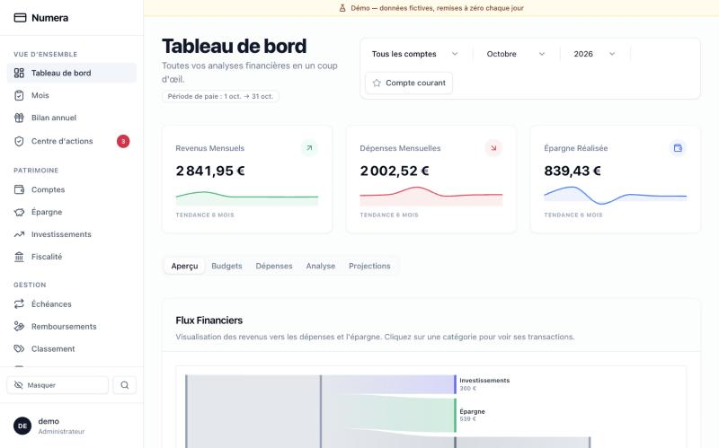
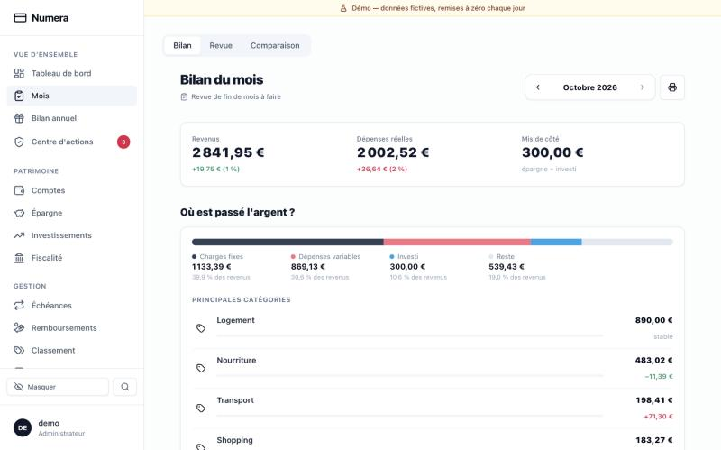
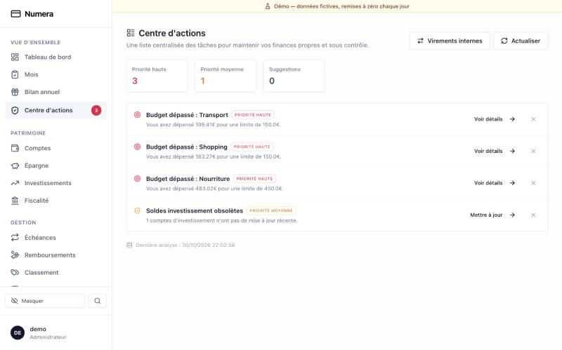
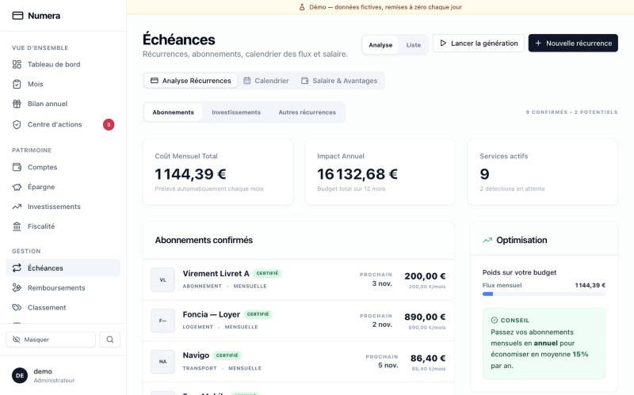
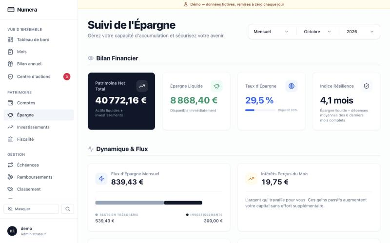
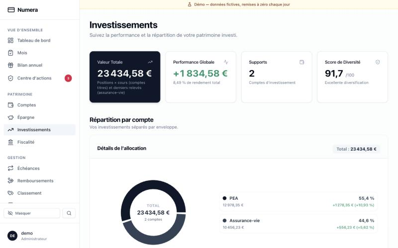

<div align="center">

<h1>Numera</h1>

<p><strong>Votre budget, votre épargne et vos investissements, au même endroit. Chez vous.</strong></p>

<p>
  <a href="https://demo-budget.galleyhugo.com"></a>
</p>

<p>
  
  
  
  
  <a href="LICENSE"></a>
</p>

<p>
  <a href="#-la-démo">Démo</a> ·
  <a href="#-ce-que-numera-fait-pour-vous">Fonctionnalités</a> ·
  <a href="#-installation-en-3-commandes">Installation</a> ·
  <a href="#-demander-à-claude">Claude</a> ·
  <a href="#-développer">Développer</a>
</p>

<br>



</div>

<br>

Pendant longtemps, j'ai suivi mon budget et mes placements dans un tableur. Ça marchait, jusqu'au jour où il y a eu trop d'onglets, trop de formules fragiles et plus aucune envie de l'ouvrir. **Numera** est l'application que j'ai écrite pour le remplacer.

- 🏠 **Vos données restent chez vous** : un simple fichier SQLite sur votre machine, pas de compte à créer, pas de cloud.
- 🔌 **Rien n'est connecté à votre banque** : vous importez vos relevés CSV quand vous voulez.
- 🌍 **Les seuls appels vers l'extérieur** servent aux taux de change et aux cours de bourse.
- 👤 **Pensé pour une personne** : pas d'usine à gaz multi-utilisateurs.

<br>

## 🎮 La démo

Le plus simple pour se faire une idée, c'est de cliquer partout :

<p align="center">
  <a href="https://demo-budget.galleyhugo.com"><strong>👉 demo-budget.galleyhugo.com</strong></a><br>
  <sub>identifiant <code>demo</code> · mot de passe <code>demo</code> (déjà remplis)</sub>
</p>

Les données sont fictives et remises à zéro chaque jour : modifiez, supprimez, importez, rien ne peut casser.

<br>

## ✨ Ce que Numera fait pour vous

### Comprendre où part l'argent

Chaque mois, un bilan clair : ce qui est entré, ce qui est sorti, ce qui a été mis de côté, et les catégories qui ont bougé par rapport au mois d'avant. Une revue de fin de mois vous guide pour tout vérifier, et une vue comparaison met deux mois côte à côte.

<p align="center"></p>

### Ne plus rien laisser filer

Le **Centre d'actions** fait le ménage à votre place : budgets dépassés, transactions sans catégorie, soldes pas à jour, règles de classement à créer. Vous traitez la liste, c'est tout.

<p align="center"></p>

### Suivre ses abonnements et ses échéances

Loyer, forfait, streaming, salaire : Numera repère ce qui revient chaque mois, vous dit ce que ça coûte sur l'année et affiche tout dans un calendrier.

<p align="center"></p>

### Faire grossir son épargne

Patrimoine net, épargne disponible, taux d'épargne, nombre de mois que vous tiendriez sans revenus, objectifs d'épargne avec leur avancement.

<p align="center"></p>

### Piloter ses investissements

Saisissez vos versements, achats, ventes et dividendes : Numera en déduit vos positions, votre prix de revient et votre performance au cours du jour. Il décortique aussi vos ETF pour montrer votre exposition réelle par pays et par secteur.

<p align="center"></p>

### Et aussi

| | |
|---|---|
| 📥 **Import CSV** | depuis n'importe quelle banque, sans doublons même si vous réimportez le même fichier |
| 🏷️ **Classement automatique** | catégories, tags et règles ; « CB CARREFOUR 1234 PARIS » devient simplement « Carrefour » |
| 🔁 **Virements internes** | détectés, ils ne gonflent ni vos revenus ni vos dépenses |
| 🧾 **Fiscalité** | PEA, PER, assurance-vie, livrets : plafonds et avantages de chaque enveloppe |
| 💼 **Salaire** | télétravail et tickets restaurant pris en compte |
| 💸 **Remboursements** | les sommes avancées qu'on doit vous rendre |
| 💱 **Multi-devises** | comptes en dollars, francs suisses ou livres, convertis automatiquement |
| 🎁 **Bilan annuel** | votre année en un coup d'œil, façon *Wrapped* |
| 🙈 **Mode discret** | un bouton masque tous les montants quand quelqu'un regarde l'écran |
| 🌗 **Thème clair ou sombre** | et une interface qui fonctionne aussi sur téléphone |

<br>

## 🚀 Installation en 3 commandes

Il vous faut **Docker** (avec Compose), `git`, `openssl` et `curl`.

```bash
git clone https://github.com/Hugo-Galley/numera.git
cd numera
./install.sh
```

Le script vous demande un identifiant et un mot de passe, s'occupe de tout le reste, et quelques minutes plus tard Numera tourne sur **http://localhost:8082**. Vous pouvez le relancer sans crainte : il garde votre configuration.

> [!IMPORTANT]
> Vos sauvegardes sont chiffrées avec la `BACKUP_KEY` du fichier `.env`. **Gardez-la précieusement** (dans un gestionnaire de mots de passe, par exemple) : sans elle, une sauvegarde est illisible.

> [!TIP]
> Envie d'essayer en local avec des données fictives ? `make backend-seed-demo`.

<details>
<summary><strong>Installer sans cloner le dépôt</strong></summary>

<br>

```bash
bash -c "$(curl -fsSL https://raw.githubusercontent.com/Hugo-Galley/numera/main/install.sh)"
```

Le dépôt est cloné dans `./numera`, puis l'installation se déroule comme ci-dessus.

</details>

<details>
<summary><strong>Tout configurer à la main</strong></summary>

<br>

```bash
make setup                                        # crée .env, génère SECRET_KEY et BACKUP_KEY
python3 scripts/change_password.py 'mot-de-passe' # nécessite bcrypt (pip install bcrypt)
```

Collez le hash obtenu dans `.env` **entre guillemets simples**, sinon Docker Compose prend les `$` pour des variables et la connexion échoue :

```env
ADMIN_PASSWORD_HASH='$2b$12$...'
```

Puis lancez `make prod`.

</details>

<details>
<summary><strong>Y accéder depuis son téléphone</strong></summary>

<br>

Par défaut, l'appli n'écoute que sur `127.0.0.1:8082`. Pour l'ouvrir depuis l'extérieur, mettez un reverse proxy HTTPS devant : Caddy, Traefik, Nginx ou un tunnel Cloudflare. L'API (`/api`) et le serveur MCP (`/mcp`) passent par ce même port, il n'y a rien d'autre à exposer.

</details>

### Mettre à jour

```bash
make upgrade
```

La dernière version est récupérée et les conteneurs reconstruits. La base se met à jour toute seule au démarrage.

### Sauvegardes

Toutes les 24 heures, une copie chiffrée de la base est déposée dans `backups/`, et les 7 derniers jours sont conservés (réglables via `BACKUP_INTERVAL_SECONDS` et `RETENTION_DAYS` dans `.env`).

<details>
<summary><strong>Sauvegarder ou restaurer à la main</strong></summary>

<br>

```bash
# Sauvegarder tout de suite
docker exec numera-backup-prod python scripts/backup.py

# Restaurer (après make prod-down)
export BACKUP_KEY=...
PYTHONPATH=backend python3 backend/scripts/restore.py \
  backups/suivi_budget_AAAAMMJJ_HHMMSS.db.enc --dest backend/data/suivi_budget.db
```

Plus de détails dans [docs/BACKUP_RESTORE.md](docs/BACKUP_RESTORE.md).

</details>

<br>

## 🤖 Demander à Claude

Numera embarque un serveur [MCP](https://modelcontextprotocol.io) : branchez-le à Claude et posez vos questions en langage naturel.

> *« Combien j'ai dépensé en restaurants ce trimestre ? »*<br>
> *« Fais-moi le bilan de septembre. »*<br>
> *« Mon portefeuille est-il trop concentré sur les États-Unis ? »*

Claude répond avec exactement les mêmes chiffres que l'appli. Pour le connecter, allez dans **Paramètres → Sécurité → Claude (MCP)**, générez un token et lancez la commande affichée :

```bash
claude mcp add --transport http --scope user numera https://votre-domaine/mcp \
  --header "Authorization: Bearer nmr_..."
```

Pour Claude Desktop, la même page fournit le bloc à coller dans `claude_desktop_config.json`.

🔒 L'accès est **en lecture seule**, et c'est l'API elle-même qui l'impose : toute écriture faite avec un token MCP est refusée, tout comme l'accès aux réglages du compte. Chaque token se révoque depuis l'interface, et un interrupteur coupe tout d'un coup. La liste des outils est dans [mcp-server/README.md](mcp-server/README.md).

<br>

## 🛠️ Développer

```bash
make dev
```

Frontend sur http://localhost:5173, API sur http://localhost:8001, avec rechargement à chaud des deux côtés. Avant de pousser : `make validate` (lint, tests backend et build du frontend).

<details>
<summary><strong>Sans Docker</strong></summary>

<br>

Il faut **Python 3.11 ou 3.12** (`pydantic-core` ne s'installe pas sous 3.14) et Node 20 ou plus.

```bash
cd backend
python3.12 -m venv venv && . venv/bin/activate
pip install -r requirements.txt
uvicorn app.main:app --reload --port 8001

# dans un autre terminal
cd frontend && npm install && npm run dev
```

Pour un seul fichier de tests : `cd backend && PYTHONPATH=. python3.12 -m pytest tests/test_tags.py -v`.

</details>

### Comment c'est construit

```
 Navigateur ──▶ Nginx ──┬── /       appli React (Vite, Tailwind, shadcn/ui, Recharts)
                        ├── /api ──▶ FastAPI ──▶ SQLite
 Claude ──────▶         └── /mcp ──▶ serveur MCP ──▶ FastAPI (lecture seule)
```

Le backend utilise FastAPI, SQLAlchemy 2, Alembic et Pydantic v2. Une règle tient l'ensemble : **tous les calculs sont faits par le backend** (`backend/app/services/`, exposés par `backend/app/controllers/`), le frontend se contente d'afficher. C'est ce qui garantit que l'appli et Claude voient les mêmes chiffres.

| Pour aller plus loin | |
|---|---|
| [ARCHITECTURE.md](ARCHITECTURE.md) | modèle de données, routes de l'API, règles de calcul |
| [docs/BACKEND.md](docs/BACKEND.md) | logs, déploiement, sécurité |
| [docs/ACTION_CENTER.md](docs/ACTION_CENTER.md) | le centre d'actions |
| [CLAUDE.md](CLAUDE.md) | consignes pour les agents IA qui travaillent sur le code |

<br>

## 🤝 Contribuer

C'est d'abord un projet personnel, mais les issues et les pull requests sont les bienvenues. Si vous touchez au schéma, ajoutez une migration Alembic ; si vous changez une route ou un calcul, mettez à jour `ARCHITECTURE.md`. Les commits suivent les [Conventional Commits](https://www.conventionalcommits.org/).

<br>

<div align="center">
<sub>Gratuit et open source, sous licence MIT · fait par <a href="https://github.com/Hugo-Galley">@Hugo-Galley</a></sub>
</div>
