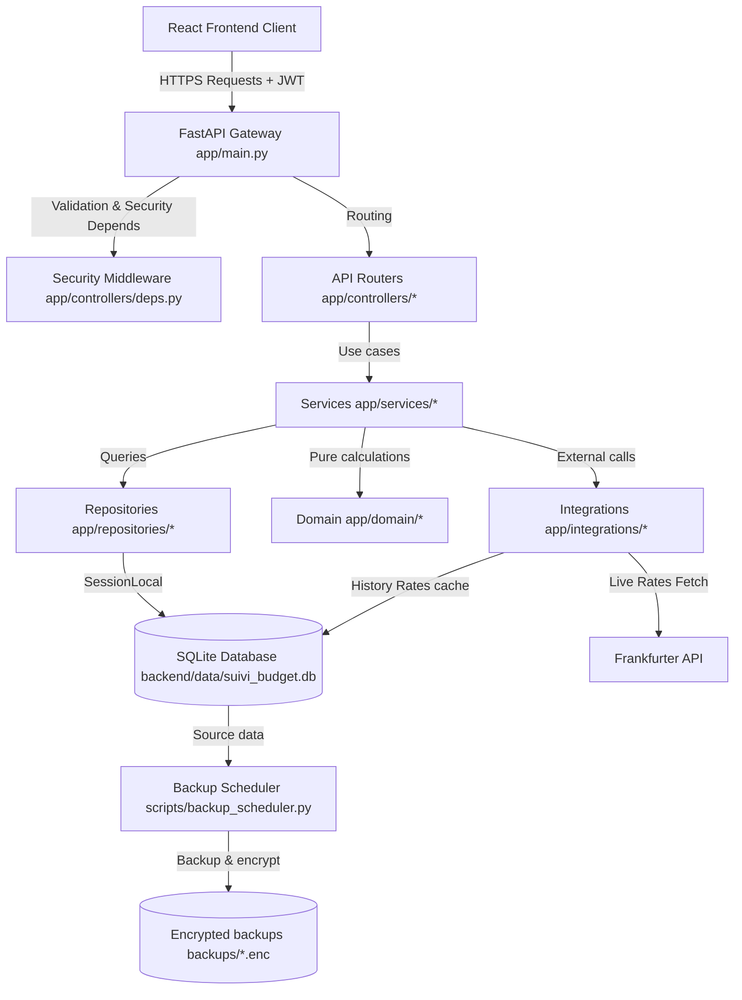

# Numera Backend: Complete Documentation

This document gives a technical, operational and architectural overview of the backend of the **Numera** application. It is intended for developers and system administrators who need to understand how the system works, how to monitor it and how to deploy it.

---

## 1. Tech Stack and Architectural Choices

Numera's backend follows a **local-first and privacy** principle. It runs locally and stores data without relying on third-party cloud services (apart from Frankfurter exchange rates and Yahoo Finance quotes/security profiles).

### The tech stack

| Technology | Component / Role | Version / Details |
| :--- | :--- | :--- |
| **Language** | [Python](https://www.python.org/) | Python 3.12 (Docker image); 3.11 works locally, 3.14 is incompatible with pydantic-core |
| **Web framework** | [FastAPI](https://fastapi.tiangolo.com/) | `0.116.1` (ASGI, asynchronous) |
| **ASGI server** | [Uvicorn](https://www.uvicorn.org/) | `0.35.0` (standard) |
| **Database** | [SQLite](https://sqlite.org/) | Local file `suivi_budget.db` |
| **ORM** | [SQLAlchemy](https://www.sqlalchemy.org/) | `2.0.43` (modern 2.0 `Mapped` syntax) |
| **Migrations** | [Alembic](https://alembic.sqlalchemy.org/) | `1.16.5` |
| **Validation and schemas** | [Pydantic](https://docs.pydantic.dev/) | `v2.11.7` and `pydantic-settings` |
| **Security** | [PyJWT](https://pyjwt.readthedocs.io) and [bcrypt](https://github.com/pyca/bcrypt) | HS256 JWT token / password hashing |
| **Tests** | [Pytest](https://docs.pytest.org/) | `8.3.3` — `PYTHONPATH=. python3.11 -m pytest tests` from `backend/` (`make test` expects a `backend/venv` that is absent here) |

### Why this stack?

1. **FastAPI and Pydantic v2**: exceptional performance (thanks to Pydantic v2's validation core written in Rust) and strong typing. Automatic generation of the interactive Swagger UI (`/docs`) and ReDoc (`/redoc`) documentation greatly eases integration with the frontend.
2. **SQLite**: a perfect fit for the **single-user** (single admin) model. SQLite removes the need to install, configure and administer a full database server such as PostgreSQL or MySQL. This guarantees a minimal system footprint and full privacy (data stays on the user's machine).
3. **SQLAlchemy 2.0 and Alembic**: they model complex relationships cleanly (for example the chaining of internal transfers, links between recurring transactions) while keeping full flexibility for schema migration during application updates.
4. **Simple JWT authentication**: in line with the private deployment model, the application uses a single administration account; the token expires after one hour of inactivity (renewed during use, session capped at 12 h).

---

## 2. Architecture and Internals

### Backend code tree

```text
backend/
├── alembic/                # Database schema migration scripts
├── app/                    # Main application source code
│   ├── controllers/        # FastAPI routers, by domain (budget, comptes, investissement, analytics, systeme) + deps.py
│   ├── services/           # Use cases (commit, business errors), same tree by domain (+ audit/)
│   ├── repositories/       # SQLAlchemy queries, same tree by domain, no commit
│   ├── domain/             # Pure calculations (no Session)
│   ├── integrations/       # External calls (Frankfurter, Yahoo Finance, ntfy/Telegram, logos, backup)
│   ├── core/               # Cross-cutting: configuration, security, errors, logs, migrations
│   ├── db/                 # SQLAlchemy connection and session
│   ├── models/             # SQLAlchemy ORM models
│   ├── schemas/            # Pydantic (v2) validation schemas
│   └── main.py             # FastAPI application entry point
├── data/                   # Directory holding the SQLite file (excluded from Git)
├── scripts/                # Utility scripts (backups, seeds, migrations)
├── tests/                  # Unit and integration tests with Pytest
├── Dockerfile              # Dockerfile for the backend container
├── pyproject.toml          # Python dependencies (uv); dev group: pytest, ruff, mypy
├── uv.lock                 # Pinned versions (uv sync --frozen)
└── alembic.ini             # Alembic configuration
```

### Application flow diagram



### Lifecycle and background tasks

When the application starts (`lifespan` event configured in [backend/app/main.py](../backend/app/main.py)):
1. **Automatic migrations**: if `APP_ENV` is not set to `test`, Alembic is run automatically through `run_migrations()` in [backend/app/core/migrations.py](../backend/app/core/migrations.py) to update the database structure.
2. **Default seeding**: the core categories and the system ETF profiles are inserted if absent, through `seed_all()` in `backend/app/services/systeme/seeds.py`.
3. **Asynchronous recurring task**: a permanent asynchronous loop (`recurring_transactions_task`) is started in the background. It runs every hour to:
   - Automatically generate the instances of recurring transactions (subscriptions, fixed charges) defined by the user (`backend/app/services/budget/recurring.py`).
   - Check and generate the transactions linked to configured salaries and declared remote-work days (`backend/app/services/budget/salary_generation.py`).

### Single worker and in-memory state

The backend must run with **a single uvicorn worker** (`docker-compose.prod.yml`). Several states live in the process memory and are not shared between workers: rate cache (`integrations/currency.py`), quote cache and negative cache (`services/investissement/market/quotes.py`), valuation cache (`services/investissement/portfolio/cache.py`), circuit breakers (`core/circuit_breaker.py`) and login limiters (`core/login_rate_limit.py`). With `--workers N`, each worker would have its own copies: stale valuation after a write handled by another worker, login attempt limit multiplied by N. Moving to several workers first requires moving this state into the database or a shared cache.

Routes are `def` (threadpool): computation and SQLAlchemy do not block the event loop. Services that wait on the network stay `async` and are called through `run_async` (`core/sync_bridge.py`).

### Major business rules

- **Running balance**: unlike other architectures, the running balance at a point in time (`running_balance`) is stored directly on each financial transaction. When a transaction is added, modified or deleted, the backend recursively and chronologically recomputes the running balances of the account concerned through `recalculate_running_balances` (`backend/app/services/budget/balances.py`, also called by the CSV import and the salary generation) to guarantee the absolute integrity of time-based charts.
- **Multi-currency handling**:
  - The application natively supports transactions in foreign currencies (USD, GBP, CHF, etc.).
  - The reference currency is the **EUR**. Conversions go through the public Frankfurter API.
  - Current rates are cached in memory for 6 hours. Historical rates are cached predictably in the SQL table `historical_exchange_rates`.
  - If the network is unavailable, the system falls back to hard-coded fallback rates in [backend/app/integrations/currency.py](../backend/app/integrations/currency.py).
- **Auto-categorisation and normalisation**:
  - The automatic categorisation engine applies text patterns based on merchants through the `categorization_rules` table.
  - Merchant aliases are normalised using the `merchants` and `merchant_aliases` tables to clean raw bank labels (for example, mapping `INTERMARCHE PARIS 15` and `INTERMARCHE LYON` to the canonical merchant `Intermarché`).

---

## 3. Security and Authentication

The application implements a simple but robust authentication system:
- **Single authentication**: a single administrator account is managed through the `ADMIN_USERNAME` (default `admin`) and `ADMIN_PASSWORD_HASH` environment variables.
- **Password generation**: to generate or change the password, a utility script is provided. You must hash the password before adding it to your `.env` file:
  ```bash
  python3 scripts/ops/change_password.py "your_password"   # from the repository root
  ```
- **JWT (JSON Web Tokens)**: on login (`POST /auth/token`), a JWT signed with `HS256` using the `SECRET_KEY` is generated. Its validity is set to **60 minutes** (configurable through `ACCESS_TOKEN_EXPIRE_MINUTES` in [backend/app/core/config.py](../backend/app/core/config.py)).
- **Security dependency**: all business routes include the `Depends(get_current_user)` dependency (`app/controllers/deps.py`), which validates the token (`401` if invalid/expired, `403` if the `sub` does not match the current admin). `POST /auth/token` is limited by `LoginRateLimiter` (5 failures / 15 min by default, configurable through `LOGIN_*`). The name and password hash can also be changed from the UI (`PUT /admin/profile`, stored in `system_settings` and taking priority over `.env`).

---

## 4. Monitoring and Logging

### Logging

The application uses Python's native logging module configured in [backend/app/core/logging.py](../backend/app/core/logging.py).

> [!NOTE]
> In development mode (`APP_ENV=dev`), the default log level is `DEBUG`. In production (`APP_ENV=prod`), it is limited to `INFO`.

Logs are sent to standard output `sys.stdout`. In a containerised environment, these logs are captured by Docker and can be read with:
```bash
docker logs -f numera-backend-prod
```

#### Automatic logging middleware
A custom HTTP middleware intercepts all requests:
- **Request tracking**: each request gets one summary log line containing the HTTP method, the resource path, the HTTP status code and the processing time in milliseconds.
  ```text
  2026-06-24 18:00:00,000 - app.main - INFO - method=GET path=/accounts status=200 duration=12.45ms
  ```
- **Exception handling**: all errors not handled at endpoint level are caught by the middleware, logged at `ERROR` level with the full traceback, before being returned as an HTTP 500 error to preserve application stability.
- **Noise filtering**: successful health-monitoring calls (`GET /health` returning a `200` status) are excluded from the logs to avoid polluting the log files.

### Health monitoring (healthcheck)

The production container includes a `healthcheck` directive:
```yaml
healthcheck:
  test: ["CMD", "curl", "-f", "http://localhost:8001/health"]
  interval: 10s
  timeout: 5s
  retries: 5
  start_period: 20s
```
The `/health` endpoint simply checks that the application responds correctly. If 5 consecutive checks fail, Docker marks the container as `unhealthy` and restarts it automatically if `restart: always` is configured.

---

## 5. Deployment Procedures

Deployment is fully orchestrated through **Docker** and **Docker Compose** for one-click installation and updates.

### Initial configuration

Before starting the production server, run the initialisation script:
```bash
make setup
# or
./setup.sh
```
This script does the following:
1. Creates a `.env` configuration file from `.env.example` if it does not exist.
2. Securely generates a random key for `SECRET_KEY`.
3. Generates a symmetric Fernet encryption key (`BACKUP_KEY`) needed for database backups.
4. Creates the local folders `backend/data/` (live database) and `backups/` (encrypted backups).

### Running the server

The project offers two run configurations, managed by the [Makefile](../Makefile):

#### Development mode
Starts the application in interactive local mode with hot reload when the code changes:
```bash
make dev
```
*The backend listens on port `8001` and the frontend on port `5173`.*

#### Production mode
Builds and starts the optimised Docker images in the background (detached mode) with automatic restart on failure:
```bash
make prod
```
*The production frontend listens on port `8082` and talks to the backend on port `8001`.*

To stop production:
```bash
make prod-down
```

#### Hardening of images and containers
- **Non-root**: backend and MCP (UID 1000, overridable for the backend with `NUMERA_UID`/`NUMERA_GID` to follow the owner of `data/` and `backups/`), nginx via `nginx-unprivileged` (port 8080 in the container, published on 8082).
- **Migrating from a root version**: files in `data/` and `backups/` created by the old containers belong to root; once, run `sudo chown -R "$(id -u):$(id -g)" data backups` (or `backend/data`) then set `NUMERA_UID`/`NUMERA_GID` in `.env`. `make dev`, `make prod` (hence `make upgrade`) and `make demo` first go through `scripts/ops/check_volumes.sh`: it creates missing mounted folders (otherwise Docker creates them as root) and refuses to start, giving the `chown` command, if a file does not belong to `NUMERA_UID` (symptom otherwise: `Backup failed: unable to open database file`).
- **Compose**: `read_only`, `tmpfs: /tmp`, `cap_drop: ALL`, `no-new-privileges`, `pids_limit` on all services; only `data/` and `backups/` are writable. Locked by `tests/garde_fous/test_docker_hardening.py`.
- **Images**: multi-stage (no compiler, `uv` or `curl` at runtime), built-in `HEALTHCHECK`, bases pinned by digest.
- **CI** (`ci.yml`): hadolint on the Dockerfiles, Trivy on the repository (dependencies, secrets, configuration) and on each image (fixable HIGH/CRITICAL findings block). Justified exceptions in `.trivyignore.yaml`. `security.yml` rescans the repository and the published images every week (results in the Security tab).
- **Release** (`release.yml`): Trivy scan before publication, SPDX SBOM and SLSA provenance attached to the image, keyless cosign signature. Verify an image:
  ```bash
  cosign verify ghcr.io/hugo-galley/numera-backend:<version> \
    --certificate-identity-regexp '^https://github.com/Hugo-Galley/numera/\.github/workflows/release\.yml@' \
    --certificate-oidc-issuer https://token.actions.githubusercontent.com
  ```
- **Dependabot** (`.github/dependabot.yml`) updates Docker digests, action SHAs, npm and uv.

#### Public demo instance
A second instance, entirely separate from production (Compose project `numera-demo`, database `backend/data-demo/demo.db`), serves a demo with fictitious data regenerated every day:
```bash
make demo        # starts on 127.0.0.1:8090
make demo-down
```
Prerequisites in `.env`: `DEMO_SECRET_KEY` (distinct from `SECRET_KEY`, `openssl rand -hex 32`) and, if the domain differs, `DEMO_CORS_ORIGINS`. Then publish port 8090 on the desired domain (tunnel / reverse proxy, e.g. `demo-budget.galleyhugo.com` → `http://localhost:8090`). Public credentials: `demo` / `demo`, shown on the login page. Credential changes, 2FA, passkeys, MCP tokens, backups and notifications are disabled there (403). Visitors' IPs and browsers are not logged; imports capped at 200 KB (413), 120 writes per minute per IP (429), backend limited to 512 MB / 1 CPU. To regenerate the demo locally: `make backend-seed-demo` (writes to `backend/data/demo.db`).

---

## 6. Backups and Restore

### The backup service

In the production configuration ([infra/docker-compose.prod.yml](../infra/docker-compose.prod.yml)), a service named `backup` runs in isolation. It starts the backup scheduler [backend/scripts/backup_scheduler.py](../backend/scripts/backup_scheduler.py).

- **Interval**: by default, the script makes a backup every 24 hours (configurable through the `BACKUP_INTERVAL_SECONDS` variable).
- **Encryption**: if `BACKUP_KEY` is set in the `.env` file, the SQLite file is encrypted with the symmetric Fernet algorithm (AES-128 in CBC mode with HMAC signature) before being written to disk. The backup file then gets the `.db.enc` extension.
- **Retention**: the script automatically purges backups older than 7 days (configurable through `RETENTION_DAYS`, 7 days by default).

### Useful backup commands

#### Trigger an immediate backup
You can force a backup at any time without waiting for the scheduler with:
```bash
make backup-now
```
This command runs the script [backend/scripts/backup.py](../backend/scripts/backup.py) inside the running container.

#### Restore a backup
To restore the database from an encrypted backup file, use the following command:
```bash
make backup-restore FILE=backups/suivi_budget_YYYYMMDD_HHMMSS.db.enc
```
The restore script [backend/scripts/restore.py](../backend/scripts/restore.py) performs the following safety steps:
1. It looks up the `BACKUP_KEY` key to decrypt the file.
2. It tries to open a SQLite test connection on the decrypted database to validate its integrity.
3. If the database is valid, it atomically replaces the live database `backend/data/suivi_budget.db`.

> [!CAUTION]
> Keep the `BACKUP_KEY` present in your `.env` file at all costs. Without this key, existing encrypted backups can never again be decrypted or restored.

---

## 7. Tests and Validation

Backend code quality and consistency are validated through automated tests:
- Unit and integration tests are run with **Pytest**.
- The test configuration uses an in-memory SQLite database or a disposable temporary database file (configured in the Pytest fixtures).
- To run the tests locally:
  ```bash
  make test
  ```
- To validate full compliance (backend tests and successful frontend build) before pushing to production:
  ```bash
  make validate
  ```
